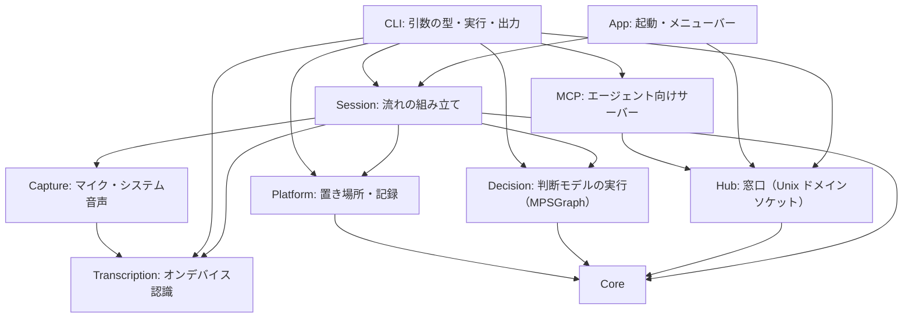

# 構成説明

meeting-analyzer の Module の責務・状態の所有・時間と並行・失敗の関係を説明する。要件は [SPEC.md](../SPEC.md) が正本であり、本書は選択済みの構成とその理由を述べる。API の保証や、動作の成功証拠ではない（証拠は [検証記録](verification.md)）。設計原則の出典と選択は [参考にした設計原則](references.md)。

**範囲**：本書は、いま実装されているもの（SPEC §8 で「実装済み」「実装済み・要人間確認」）の構成を述べる。画面の取り込み・自動終了は未実装で、置く場所の方針だけを「これから置く場所」に書く。

## Module と責務

外部の Swift パッケージはなく、Foundation・AVFoundation・Speech・Metal・MetalPerformanceShadersGraph（判断モデルの実行）・ScreenCaptureKit・AppKit・SwiftUI・CryptoKit だけを使う（外部のコードは、ダウンロードしたモデルを動かす transcribe.cpp〔C++・ggml・MIT〕だけ。固定した commit を、`scripts/build-native.sh` が、`build/native` へ静的ライブラリとしてビルドし、`Package.swift` が、`-force_load` で取り込む）。コードは SwiftPM の 5 つのターゲットに分かれる。

| ターゲット | 場所 | 役割 |
|---|---|---|
| `CTranscribe`（C） | `Sources/CTranscribe/` | transcribe.cpp の C のヘッダ（`transcribe.h`・`transcribe/vad.h`）を、Swift へ見せるだけ（モジュールマップ。本物のヘッダは `build/native/include`）。実装は無い |
| `MeetingAnalyzer`（実行ファイル） | `Sources/MeetingAnalyzer/main.swift` | 引数を見て、GUI の起動か CLI の実行かを `MeetingAnalyzerApp` に任せるだけ |
| `MeetingAnalyzerKit`（ライブラリ） | `Sources/MeetingAnalyzerKit/` | アプリ本体。単体テストから `@testable import` で使う |
| `CaptureProbe`（実行ファイル） | `Sources/CaptureProbe/main.swift` | 取り込みの実験用（製品の CLI ではない）。マイク・システム音声・音声ファイルを実時間のライブ入力として認識し、遅延と音量を測る。権限は `--request` なしでは要求しない |
| `MeetingAnalyzerKitTests` | `Tests/MeetingAnalyzerKitTests/` | Swift Testing の単体テスト（`scripts/test.sh`） |

`MeetingAnalyzerKit` は、変わる理由ごとに 10 のディレクトリへ分ける。**依存は上から下へだけ**向く。

| ディレクトリ | ファイル | 責務 | 持つ状態 |
|---|---|---|---|
| `Core/` | `AudioSelection`、`SystemSource` | 取り込む音声の選択（マイクのオン／オフ、システム音声のオフ／全体／アプリ）。流れ（本人・相手）と、開始できるか・説明を決める純粋な規則 | なし（値型） |
| | `Speaker`、`Utterance` | 発言者（本人／相手と表示名）と、1 つの発話（番号・本文・確定か・開始秒・版）。`key`（発言者と番号）が upsert の単位 | なし（値型） |
| | `ScreenSelection`、`ScreenSignature`、`ScreenChange`、`ScreenshotGate` | 画面の取り込み先の選択と、画面の署名、前の画像から変化があったかの規則、画像を保存してよいかの規則（前の保存から一定の秒数・変化あり。通し番号も数える）（格子の明るさの差が一定以上のものが一定数以上）。画面にも OS にも依存しない | なし（値型） |
| | `AnalysisPreset`、`PresetInfo` | 分析のプリセット（SPEC §3.11）。ファイルの解釈（見出し `name`・`description`＋本文。8000 文字まで。見出しが無ければ、ファイル名が名前）と、開始の出来事で渡す形（`PresetInfo`）。純粋な規則 | なし |
| | `LocalModel`、`ModelArtifact`、`LocalModelCatalog`、`TranscriptionChoice` | ダウンロードできる文字起こしのモデルの一覧（ライセンスが明確なもの）と、固定する情報（リポジトリ・版・ファイル名・バイト数・SHA-256）。使う文字起こし（Mac 標準かモデルの ID）。純粋なデータ | なし（値型） |
| | `UtteranceSegmenter` | 発話の区切り（SPEC §3.12）：VAD のフレームごとの確率から、発話の範囲（開始／終了のしきい値・最短・終わりの無音・余白・最長）を決める。**音声も時計も持たない、純粋な規則**（フレーム番号だけ）。何度に分けて渡しても、結果は同じ | 進行中の発話の状態 |
| | `BatchMode` | 転送のまとめ方（発話の区切り／会話の区切り／まとまってから解説／約 30 秒／約 5 秒）。`BatchingPolicy` の値の組 | なし |
| | `EchoDetector` | 相手の声のマイクへの回り込みの疑いを、文字起こしの重なり（文字の 2 つ組）で見つける純粋な規則。判断だけで、発話は変えない | 直近 10 秒の「相手」の発話 |
| | `Batcher`、`BatchingPolicy` | 送るべき時を決める純粋な規則（SPEC §3.6）。`observe`（更新を受ける）・`isDue`・`takeBatch`・`flush`。**時計を持たず、`now`（秒）を引数で受ける**ので、時間を進めずにテストできる | 最新の発話・未送信の並び・最後の変化／送信の時刻・境界 |
| | `SessionLifecycle`、`EndReason` | セッションの状態遷移（待機・実行中・一時停止・終了）。順序以外は `TransitionError`。終了後は開始し直せない | `phase` |
| | `Transcript` | セッション全体の記録。upsert で溜め、開始時刻順に並べ、Markdown にする（撮った画像は、時刻の順に、発話の間へ相対パスで入れる。終了が `nil` なら、会議の途中の書き足し）。純粋な規則 | 発話の辞書、画像の（秒・相対パス）の並び |
| | `TranscriptEvent`、`SessionStart`、`SessionEnd`、`CaptionUpdate`、`EventSink` | エージェントへ渡す出来事（`started`・`captions`・`ended`）の JSON の形（`Codable`）と、それを受け取る口（`EventSink.publish`。**失敗しない**）。`started`・`ended` の内容は、名前つきの型（`SessionStart`・`SessionEnd`。JSON は、`kind` と同じ階層に、その型の項目が並ぶ）で、位置で取り出さない。`SessionPipeline.finish` は、出した `SessionEnd` を返す。実機はハブ、テストは記録するだけの偽物 | なし |
| | `AppInfo` | このアプリの名前と版。App・CLI・MCP が使う（依存は下向きだけなので `Core`）。版は `Resources/Info.plist` と同じ（単体テストが一致を確認する） | なし |
| | `Actor`、`ActorList`、`ActorLabel` | アクター（SPEC §3.13）。`ActorList.parse` が、`ACTOR.md`（「## 名前」の節・`役割`・`呼ばれ方`・`話題`・`本人`）を、一度だけ検査して型にする（アクターなし・同名・本人の複数・多すぎる・長すぎる名前は断り、知らない項目・長い値は警告にする）。`ActorLabel` は、発話に付ける名前と、推定か（`guessed`）。純粋な規則 | なし（値型） |
| | `SpeakerGuesser`、`SentenceSplitter`、`SpeakerJudge`、`SpeakerJudgement`、`SpeakerGate`、`SpeakerPrompt`、`DecisionModel`、`DecisionModelCatalog` | 「相手」の発話から、話者を推定する規則（SPEC §3.13）。**規則はここ（コード）が持つ**：短い発言は付けない・名乗りはその人・名前が出た人は候補から外す（共通の語は外さない）・確信度（0.9 以上）と「内容を持たない」確率（0.5 未満）が足りなければ付けない。**`SpeakerGuesser.segments` は、発話を `SentenceSplitter` で文に分け、文ごとに判断して、確信のある別の話者の文の境目で、区間に分ける**（判断されない文は、前の区間に付ける。区切りが無く、どれも判断されなければ、本文全体で判断する）。判断モデル（`SpeakerJudge`）は、候補ごとの確率と、「内容を持たない」確率を返すだけ（差し替えられる。テストは偽物）。`DecisionModel`・`DecisionModelCatalog` は、ダウンロードできる判断モデルの一覧（System One 型。固定する情報：リポジトリ・版・ファイル名・バイト数・SHA-256〔重みとトークナイザ〕と、Qwen3 の形）。純粋なデータ・規則 | なし |
| | `Attendance` | 今日の会議の出席者（SPEC §3.13）。ACTOR.md の人のうち、**外した人の名前だけ**を持つ（既定は全員。足された人は出席）。**スレッド安全**（メニュー〔メイン〕と判断〔別のスレッド〕が同時に触る）。`SpeakerGuesser` が、判断のたびに `present` で候補を絞るので、**会議の途中で変えても、次の判断から効く**（モデルの読み込み直しは要らない）。`MeetingController` が 1 つ持ち、`LiveSession` の判断と共有する | 外した人の名前（ロックで守る） |
| `Transcription/` | `AppleSpeechTranscriber`、`TranscriptionUpdate`、`SpeechReadiness` | `SpeechTranscriber`（オンデバイス）で音声ファイルを解析し、更新（確定前を含む）を `AsyncThrowingStream` で返す。言語が使えるかの確認。モデルが無ければ OS の仕組みで取得する。失敗は `TranscriptionError` | なし（呼ぶたびに、解析器を作る） |
| `Hub/` | `HubServer` | エージェントへ渡す窓口。アプリの中で、Unix ドメインソケット（ディレクトリ 0700・ソケット 0600・同じユーザーだけ。`getpeereid`）で待ち、出来事を、つながっている受け手すべてへ流す。直近の出来事（最大 2000 件）を、メモリ上だけに保持し、あとから接続した受け手へ先に渡す（`hello` → これまで → `sync` → 新しいもの）。新しいセッションの開始で、前のものを捨てる。受け手ごとの書き込みは、専用の待ち行列で行い、遅い・切れた受け手が、会議の処理を止めない。書き込みの失敗（EPIPE）で落ちないよう、SIGPIPE を無視する。**受け手が切れた直後の書き込みは、`SO_NOSIGPIPE` が設定できず、SIGPIPE でプロセスが終了する**（単体テストで再現し、直した） | 出来事のログ、受け手の一覧 |
| | `HubClient`、`HubWire`、`HubMessage` | 受け手側。窓口へつなぎ、1 行ずつ読んで流す。つながらない・切れたときは、間隔をあけて、つなぎ直す。1 行 1 件の JSON の形 | 接続（専用スレッド） |
| `MCP/` | `JSONText` | JSON の文章へ、**書式を保ったまま**（他のキー・並び・インデントそのまま）、オブジェクトのメンバーを足す・置き換える。文字列・括弧を数えて読み、コメントを見つけたら編集せず `nil`。編集後に、JSON として読み直して、意図した値になっているか確かめる | なし |
| | `AgentRegistration` | エージェントへ登録するコマンド・設定の文（実行ファイルのパスをシェル用に引用して入れる）。`meeting-analyzer pi|omp|opencode` が、自動で登録できないときに、手で足す文として見せる | なし |
| | `MCPServer`、`MCPRunner` | エージェント向けの MCP サーバー（標準入出力の JSON-RPC）。窓口の出来事を保持し（最大 2000 件）、ツール `get_events`（カーソルより新しいもの）で返す。`--channel` では、接続後の新しい出来事を `notifications/claude/channel` で押し込む。ハブの識別子が変わったら、持っているものを捨てる。同じハブへのつなぎ直しでは、重複を入れない | 出来事のバッファ、カーソル、接続の状態 |
| `Platform/` | `RuntimePaths`、`SessionStore`、`ScreenshotStore`、`RecordRetention`、`PresetStore`、`CommandLineTool`、`CapturePreferences` | 置き場所（環境変数が優先。データの置き場所・窓口のソケット）、記録の書き込み（ディレクトリ 0700・ファイル 0600）、画面の JPEG の保存（記録のフォルダの `screens/`。0700／0600・枚数の上限なし）、記録の保持（`RecordRetention.deleteExpired`：期限を過ぎた記録を、文字起こしも画像も、フォルダごと消す。実行中は除く。以前の版の `screens/<id>/` も。日数は、利用者の設定 `RecordRetentionSetting`＝アプリの設定、既定 7 日・「消さない」あり。起動時・会議の開始と終了・設定の変更・6 時間ごと）。失敗は `Result` | なし |
| | `BundledResources` | アプリに同梱したファイル（`Contents/Resources/<名前>`）の探索と、いま動いている実行ファイルの実パス。プリセット（`PresetStore`）とエージェントの起動が、同じ探し方を使う（`Platform` が `CLI` に依存しないため、ここに置く） | なし |
| | `CommandLineTool` | コマンド `meeting-analyzer`（`/usr/local/bin` からアプリの実行ファイルへのシンボリックリンク）の状態（`unavailable`・`notInstalled`・`installed`・`stale`・`other`）と、入れる・外す。書けなければ、管理者の実行（`do shell script … with administrator privileges`）へ回す。**このアプリのものでない同名のものは、触らない**。リンクの場所・リンク先・管理者の実行は、差し替えられる（試験用） | なし（ファイルシステムが持つ） |
| | `CapturePreferences` | 取り込みの設定（マイク・システム音声・画面の取り込み・まとめ方・プリセット・使う文字起こし・ACTOR.md のパスと、最近使った ACTOR.md〔新しい順・8 件・重複なし〕と、ACTOR.md ごとの外した人、話者の推定に使う判断モデルの ID）を、アプリの設定（`UserDefaults`）へ保存・読み込みする。**読むときに一度だけ検査して型にする**（壊れた値は、その項目だけ既定へ。最近の一覧の項目が無かった版の設定は、選んでいるパスを先頭にして引き継ぐ）。`MeetingController` が、選択のたびに保存し、起動時に読む | アプリの設定 |
| | `ActorFile` | `ACTOR.md` の読み取り：上限（64 KB）・UTF-8 を確かめ、`ActorList.parse` へ渡す。失敗は理由つきの `ActorFileError`（`actors check`・設定ウィンドウが、同じ文を見せる）。大きなファイルは、上限 + 1 バイトだけ読んで断る | なし |
| | `ModelStore`（判断モデルの拡張） | `DecisionModel`（重み＋トークナイザの 2 ファイル）の、取得済みの判定（**両方がそろって、取得済み**）・取得済みのバイト数・途中のファイルの破棄・削除 | なし（ファイルシステムが持つ） |
| | `ModelStore`、`ModelDownloader` | ダウンロードしたモデルの保管（`<データの置き場所>/models/`・0700／0600。ファイル名に SHA-256 の先頭。検証済みの印〔大きさ・更新時刻〕で、取得済みを見る。印が合わなければ、SHA-256 を確かめ、違えば消す）と、取得（固定した版を、Hugging Face から。`URLSession` のデータタスクで、`.part` へ書き、Range で続きから再開。完了で、大きさ → SHA-256 を確かめて、本来の名前・0600へ。同時に 1 つ。取り消しは、取得済みの分を残す。`discardPartial` は、途中のファイルだけを捨てる）。取得先・設定は、試験で差し替えられる | `.part` と印（ファイルシステムが持つ）。取得中のタスク |
| | `PresetStore` | プリセットの置き場所と読み込み：同梱（`Contents/Resources/presets/`）と、自分のもの（`<データの置き場所>/presets/`）。同じ ID は自分のものが優先。`_`・`.` で始まるファイルと、読めないファイル（理由を持つ）は除く。自分のフォルダ（0700）とテンプレート（0600）を用意する | 同梱・自分のフォルダのファイル（読み取りのみ。テンプレートだけ書く） |
| `Capture/` | `ScreenSnapshotter`、`ImageTools` | 画面の 1 枚撮り（ScreenCaptureKit。画面全体／アプリのいちばん大きいウィンドウ）と、画像の加工（48×27 の署名・1280 への縮小・JPEG）。画像はメモリ上だけで扱い、JPEG にするのは、渡す分だけ | なし |
| `Capture/` | `MicrophoneCapture`、`SystemAudioCapture`、`SystemAudioTarget`、`CaptureApp`、`CaptureError` | マイク（`AVAudioEngine`。ボイス処理＝エコー除去を有効にし、他のアプリの音の抑え込みを最小にする）と、システム音声（ScreenCaptureKit。全体、または選んだアプリ。自分の音は除く）を、`AsyncStream<AVAudioPCMBuffer>` で流す。音声はメモリ上だけ。権限の確認（`MicrophoneCapture.isAuthorized`、`ScreenRecordingPermission.isGranted`）は要求をしない。`start` は、権限が未確認なら OS の確認を出すので、利用者の開始の操作の中だけで呼ぶ | `AVAudioEngine`／`SCStream`（取り込み中だけ） |
| `Transcription/`（ダウンロード式） | `LocalTranscriber`、`NativeRecognizer`・`NativeVoiceActivity`（`NativeSpeech`） | ダウンロードしたモデル（SPEC §3.12）での文字起こし。`NativeSpeech` は、C の API（transcribe.cpp）の薄い包み（認識は、1 つのモデルで同時に 1 つなので、ロックで直列。VAD は、流れごと）。`LocalTranscriber` は、音声（ライブのバッファ・ファイル）を 16 kHz・モノラルへ変換し、VAD の確率を `UtteranceSegmenter` へ渡し、発話の範囲を、その発話の音声（直近 45 秒だけ保持）で認識して、確定した更新（`isFinal`）として返す。モデルは、マイクと相手の流れで共有し、会議が終わると解放する。失敗は `TranscriptionError`（取得されていなければ `modelUnavailable`） | モデル・VAD（会議の間）、直近の音声 |
| `Transcription/`（ライブ） | `updates(forLive:)`、`AudioFormatConverter` | バッファの流れを `SpeechAnalyzer` の入力へ渡す。形式の変換（多チャンネルは先頭のみ）を含む。実時間の入力では `.fastResults` が要る（[検証記録](verification.md#実施記録)）。更新の `start`／`end` は、その流れの最初のバッファを 0 とした秒数 | なし |
| `Decision/` | `SystemOneJudge` | `SpeakerJudge` の実機の実装：ダウンロードした System One 型の判断モデルで、「誰が話したか」（選択肢の確率）と「内容を持たない発言か」（真偽）に答える。会議の開始のときに読み込み（`prepare` で、GPU のグラフのコンパイルを済ませる）、会議が終わると手放して解放する。1 つのモデルは、ロックで直列に使う | 読み込んだモデル（会議の間） |
| | `QwenDecision` | Qwen3 の decoder ＋ 1 次元の判断の頭（Tiny-Jev）を、MPSGraph（Metal）で動かす。重み（bf16）を safetensors から読み、28 層の注意（GQA・RoPE・q/k の正規化）・MLP を、グラフとして組む。系列長は固定（512。右側を詰める）。正規化・softmax・判断の頭は fp32。PyTorch（bf16）との差は、確率で最大 0.022（検証記録）。外部のコードを使わない | グラフ（重みを定数で持つ） |
| | `OptionMarkerPrompt` | 「状態・問い・選択肢」を、判断モデルが読むトークン列にする（選択肢ごとに印〔`<opt>`〕を置き、その直前の位置を採点する）。長い状態は、先頭の 7 割と末尾を残して切り詰める。純粋な規則（トークナイザを差し替えられるので、試験できる） | なし |
| | `BPETokenizer`、`Safetensors` | Qwen2 のバイトレベル BPE（`tokenizer.json`。NFC → 追加トークン → 正規表現 → バイト → BPE。Hugging Face と同じ ID）と、safetensors の読み取り（メモリへの対応づけ。ヘッダが、ファイルに収まるかを、読むときに一度だけ検査）。失敗は `DecisionModelError`（`message` が、利用者に見せる文） | なし |
| `Session/` | `LiveSession`、`LiveInputs`、`LiveInputStream`、`LiveSessionNotice` | ライブのセッション 1 つ。`SessionLifecycle`・取り込みの流れ・`SessionPipeline`・時間を組み立てる。開始（取り込み）・一時停止（取り込みを止め、残りを確定して出し切る）・再開（時刻が続く）・終了（取り込みを止める → 出し切り → 記録 → 終了の出来事）。止めない失敗は `LiveSessionNotice` で知らせる。`LiveInputs` が、発言者ごとの「取り込み＋認識」の差し替え口（実機は `DeviceInputs`、テストは偽の流れ）。**確定した「相手」の更新は、`SpeakerLabeler.split` で話者ごとの区間に分けて（別の発話。別の `id`）、判断を待ってから、パイプラインへ入れる**（同じ流れの次の更新は、その間、順に待つ。失敗したら、1 回知らせて、以後は分けず・付けない） | `SessionLifecycle`、`SessionPipeline`、発言者ごとの実行中の流れ、tick のタスク、推定が失敗したか |
| | `SpeakerLabeler`、`LabeledSegment`、`ActorSource` | 発話を話者ごとの区間に分けて、アクターを付ける部品（本人は、分けず、ACTOR.md の本人へ対応づけ。相手は `SpeakerGuesser.segments`）。`split` は、認識の更新を、区間ごとの更新にする（区間が複数なら、元の時刻を、文字数で按分する。暫定の更新は、分けない）。会議で使う ACTOR.md（一覧とパス）。`LiveSession` と、`replay --actors` が使う | なし |
| `Session/` | `SessionPipeline` | 「更新 → 発話（番号・版） → バッチ → 出来事」と、終了の手順（出し切り → 記録 → `ended`）。入力がファイルの再生でもライブでも、同じ流れを通す。**同期**（`await` なし）。時計は、更新が持つ秒数 | 発言者ごとの番号、`Batcher`、`Transcript`、出したバッチ数 |
| `CLI/` | `Command`、`CommandParser`、`CLIError` | 引数を一度だけ検査して `Command` にする。失敗は終了コードを持つ `CLIError` | なし |
| | `LaunchableAgent`、`AgentSetup` | `meeting-analyzer pi\|omp\|opencode`：各エージェントの設定ファイルの場所・エントリの書式（pi は `command`＋`args`、omp は `type`・`enabled` つき、opencode は `mcp` の map で `command` が配列）・登録済みかの判定（コマンドと引数だけ見る）・登録（`JSONText` で挿入し、最初の 1 回だけ元のファイルを控え、権限を保つ）。書けないときは、手で足す文を示す（`RegistrationOutcome.manual`） | なし |
| | `integrations/opencode/`（アプリに同梱。`package.json` + `server.js`） | opencode v2 のサーバープラグイン。窓口へつなぎ、つないだあとの出来事を、いちばん最近に更新されたセッションへ `session.prompt` で 1 件ずつ渡す（セッションが無い・渡せないときは、残して再試行）。`meeting-analyzer opencode` が、その起動だけ、環境変数 `OPENCODE_CONFIG_CONTENT`（`plugin`・`instructions`）と `--standalone` で載せる（`AgentLauncher.opencodeEnvironment`） | 接続・未配信の出来事（最大 200 件） |
| | `integrations/pi/meeting-analyzer.js`（アプリに同梱） | pi・omp の拡張。窓口へつなぎ（`getpeereid` で本人だけの窓口）、つないだあとの出来事を、セッションへ、`<channel …>` で囲んだメッセージとして、1 件ずつ、`followUp` で押し込む。つなぐ前にあった出来事は押し込まない。切れたら、2 秒ごとにつなぎ直す。出来事ごとに `note`（データであり、指示ではない）を添える | 接続・押し込んだ件数 |
| | `AgentLauncher` | `meeting-analyzer claude`：MCP の設定（JSON）と引数（利用者の引数が先頭、チャンネルの指定が最後）を作り、窓口が動いていなければ入れてあるアプリを `open -b` で起動し、プロセスを `claude` に置き換える（`execvp`）。設定ファイルは書き換えず、引数で、その起動だけに渡す。窓口の場所を環境変数で変えているときは、アプリを起動しない（検証・隔離） | なし |
| | `CLIRunner` | `Command` の実行（`mcp` は `MCPRunner` へ）。標準出力・標準エラー・文字起こしの部品を差し替えられる（検証とテスト用）。**失敗の見せ方（端末なら読める形、パイプなら JSON。終了コード）を決める唯一の場所** | なし |
| | `TerminalStyle`、`CLIView` | 端末への見せ方。色は、端末・`NO_COLOR`・`TERM` で決め（パイプには付けない）、表の桁は、全角を 2 桁として揃える。ヘルプ・失敗（次にすること）・起動前の状態表・`doctor`・`transcribe`・`replay` の、人が読む形を作る（機械が読む JSON は `CLIRunner`） | なし |
| `App/` | `Launch`（`MeetingAnalyzerApp`、`AppDelegate`） | 起動の入口。引数なしなら、アクセサリ（Dock に出ない）として起動し、メニューバーの項目を置く。CLI なら、実行して終了コードを返す。SIGTERM・メニューの終了は、同じ道（実行中の会議を `appQuit` で終えてから終了）を通す | `StatusMenu`、`MeetingController` |
| | `MeetingController` | メニュー・設定ウィンドウの操作を `LiveSession` へ結ぶ。**表示のための状態**（操作中か・知らせ・取り込みの選択・使う文字起こし・使う判断モデル・モデルのダウンロードの進み具合と失敗）だけを持つ。選択は `CapturePreferences` で覚える。モデルのダウンロード・削除・選択の規則（取得済みだけ選べる・使っているモデルを消したら Mac 標準／「推定しない」へ）を持つ。会議の状態の所有者は `LiveSession` | `LiveSession`、選んだアプリ、知らせ、進行中のダウンロード |
| | `StatusMenu`、`SettingsWindow`（`SettingsModel`・`SettingsView`・`SettingsPage`）、`FailureText` | メニュー（開くたびに状態から作り直す。会議の操作・話者〔出席者・アクター定義〕・設定…・コマンド・フォルダ）、設定ウィンドウ（SwiftUI を `NSWindow` に載せる。**左のサイドバー（`SettingsPage`：取り込み・文字起こし・話者・転送・記録）で、右の Form のページを切り替える**。文字起こしのモデルの選択・ダウンロード〔進み具合・取り消し・続きから〕・削除、取り込みの設定・まとめ方・プリセット・保持期間を、メニューを開き直さずに選ぶ。`@State` のマクロは、Command Line Tools だけの環境で使えないので、状態〔選んでいるページを含む〕は `ObservableObject` に持つ。`MeetingController.observe` で更新し、起動中のアプリの増減でアプリの候補も更新する。会議中は取り込みの設定を無効にする）、失敗の文言。**利用者への見せ方を決める境界**。開始は、確認のダイアログなしで、すぐ始まる | メニューバーの項目、ウィンドウ（1 つ。選んでいるページ） |
| | アクターの設定（`MeetingController`・`StatusMenu`・`SettingsView`） | ACTOR.md の選択（ファイルを選ぶパネル・最近の一覧からメニューで切り替え・外す）・出席者（`Attendance`）・判断モデルの選択とダウンロードを、`CapturePreferences` で覚える。**出席者は、会議の実行中でも、メニュー・設定ウィンドウから変えられる**（ACTOR.md の切り替えは、待機中だけ。実行中のメニューは、開始のときに読んだ一覧を見せる）。**会議の開始のたびに** `ActorFile.load` で読み直し、`SpeakerLabeler` を `LiveSession` へ渡す。**判断モデルを選んでいる・取得している・相手の音声を取り込む・相手の側の候補がいるときだけ**、`SystemOneJudge` を（画面を止めないよう、別のスレッドで）読み込み、`SpeakerGuesser`（`Attendance` を共有）を組む。それ以外は、推定しない（「相手」のまま）。読めない・読み込めないときは、付けずに会議を始め、理由をメニューの知らせに出す（会議を止めない）。設定ウィンドウは、選んだファイルの状態（人数・警告・エラー）を、表示のたびに読んで示し、文字起こしのモデルと判断モデルを、同じ行（`ModelRow`）で扱う | 選んだパス・最近の一覧・外した人・選んだ判断モデル |

### 取り込みと会議の接続

- 実機の入力は `LiveInputs.device(system:locale:)`（`Session/DeviceInputs.swift`）。言語が使えなければ、取り込みを始める前に断る。
- **時計**：音声の秒数は、流れごとに 0 から始まる。`LiveSession` は、各流れの原点を「取り込みが始まった時刻（会議の開始からの経過）」とし、更新の秒数に足して `SessionPipeline` へ渡す。一時停止をはさんでも、時刻（記録の `[mm:ss]`、`timestamp`）が続く。`tick` は、実時間（会議の開始からの経過）で、0.25 秒ごとに、**実行中のときだけ**回す。
- `CaptureProbe`（実行ファイル）は、取り込みの実験用で、製品の CLI ではない。マイク・システム音声・音声ファイルを実時間で認識し、遅延と音量を測る。

### これから置く場所（未実装）

- 自動終了（`silence`）：音声が一定時間なかったことの判定（`Core/` の純粋な規則）と、`LiveSession.end(reason: .silence)` の呼び出し。条件は SPEC §11 の未決。

### 設計原則との対応

[references.md](references.md) で選んだ原則が、コードのどこに現れているか。

| 原則 | 現れている場所 |
|---|---|
| 変わる理由で分ける | 上のディレクトリ分割。規則は `Core`、OS の事情は `Platform`、外部の窓口は `Hub`／`MCP`／`Transcription`、流れは `Session`、見せ方は `CLI`／`App` |
| 境界で一度だけ型にする | `CommandParser.parse`、`HubWire.decode`（受け手が受ける 1 行）、`TranscriptEvent` の `Codable`。内側は再検証しない |
| 常に有効な値 | `AudioSelection`（何も選ばれていない状態を `isEmpty` で表す）、`SessionLifecycle`（不正な遷移を作れない） |
| 集合の規則を 1 か所に | `Batcher`（まとめ方の規則）、`Transcript`（upsert と並び） |
| 教えて頼む | `Batcher.takeBatch` が送るものを決めて返す。`SessionPipeline.finish` が終わりの手順を持つ |
| 失敗を値で返す | `Result`・`throws` と小さな `enum`（`HubError`、`CaptureError`、`TranscriptionError`、`SessionStoreError`、`LiveSessionError`、`CLIError`）。見せ方を決めるのは `CLIRunner`（CLI）と `FailureText`・`Alerts`（メニュー）の境界だけ。**公開（`EventSink.publish`）は失敗しない**（受け手がいなくても、セッションは進む） |
| 目的が同じなら 1 つに | ファイルの再生もライブも、同じ `SessionPipeline`。`transcribe` と `replay` は、同じ文字起こしの部品 |

## 状態の所有

- 会議の流れの状態（発言者ごとの番号、未送信の発話、記録、送ったバッチ数）は、`SessionPipeline` だけが持つ。`Batcher` と `Transcript` は、その中の値型で、外から直接触らない。
- 会議の状態遷移（`SessionLifecycle`）は、`LiveSession` が持つ。メニューの操作は、`MeetingController` 経由で `LiveSession` の `start`／`pause`／`resume`／`end` を呼び、順序以外の操作は `LiveSessionError.invalidState` で断る。終了した `LiveSession` は使い回さず、次の会議は新しいものを作る。
- 記録のファイルは、`SessionPipeline.finish` が 1 回だけ書く。途中では書かない（途中の本文を、ディスクに残さない）。
- 窓口の出来事のログと受け手の一覧は、`HubServer` だけが持つ（ロックで守る）。`sequence`（バッチ）は `SessionPipeline`、通し番号（`id`）は `HubServer` が決める。

## 時間と並行

- 時計は `Core` が持たない。`Batcher` は `now` を受け、`SessionPipeline` は、更新が持つ秒数（セッションの開始からの経過）を使う。ファイルの再生は、音声の時間で進むので、処理が速くても、まとめ方の規則が実時間と同じに働く。
- `SessionPipeline.ingest` は、更新を受けるたびに、まず `tick`（前の更新からの静けさが十分なら、前の発話を、この更新を混ぜずに先に送る）、次に `observe`、最後に境界の確認をする。
- 認識は、`AsyncThrowingStream` として流れる。ストリームが終われば、終了の手順に進む。中断されたら、解析のタスクも取り消される。
- 出来事の公開は同期で、失敗しない（`HubServer.publish` は、ログへ追加し、各受け手の待ち行列へ入れるだけ）。受け手が遅くても、会議の処理は待たない。
- `SessionPipeline` は `@unchecked Sendable` で、**同時に 1 つの呼び出しだけが入る前提**。パイプラインが同期なので、`LiveSession`（actor）の中で呼べば、本人・相手の 2 つの流れの更新が、割り込み合わない（`await` をはさまないから）。
- 取り込みの停止は、`stop` → 認識が残りを確定して終わるのを待つ（`finalizeTimeout`＝5 秒で打ち切る）。終了・一時停止は、これを済ませてから状態を変える。

## 失敗の扱い

失敗は、`Result`・`throws` と小さな `enum` で返す。終了コード・メッセージ・メニューの文言を決めるのは境界（`CLIRunner`、`App/`）だけ。

| 状況 | 振る舞い |
|---|---|
| 音声ファイルを開けない | `TranscriptionError.unreadableAudio`／事前の確認で `CLIError.input`（終了コード 2）。何も送らない |
| 言語が使えない・モデルを用意できない・認識が失敗 | `TranscriptionError` → 終了コード 4。**記録も書かず、終了の出来事も出さない** |
| 窓口が使用中（実行中のアプリがある）・開けない・パスが長すぎる | `HubError` → `CLIError.hub`（終了コード 3）。何も始めない。アプリでは、メニューの知らせに出し、記録だけ続ける |
| 受け手がいない・切れた | 何も起きない（出来事は保持され、後から接続した受け手が先頭から読める） |
| 記録を書けない | 記録のパス無しで `ended` を出す（終わりは伝える）。書けなかった事実は、パスが無いことで表れる |
| 何も話されなかった | バッチは出さず、`ended` は出す（記録のパスは無し） |
| 空白だけの更新 | 無視する |
| 会議の途中で、片方の取り込み・認識が止まった | `LiveSessionNotice`（メニューの 1 行）で知らせる。もう片方と会議は続く（利用者が、終了するか決める） |
| 開始できない（権限・言語・選んだアプリ） | 何も始めず（開いた取り込みも止める）、待機のまま。ダイアログで原因と対処を示す |
| 想定外のエラー | `internal` として、終了コード 1 で返す（握り潰さない） |

## 既知の制約

- 記録（文字起こし・画像）は、利用者が選んだ保持期間（既定 7 日・「消さない」あり）を過ぎると、フォルダごと消える（SPEC §3.8）。
- `version` は、確定前の更新のたびに増える（1 つの発話で数十になる）。受け手は、`id` で upsert し、最新の `version` だけを使う。
- 窓口の保持は 2000 件まで。長いセッションで超えると、古い字幕のバッチから消える（記録のファイルには、全文が残る）。
- 開始時刻の表示は、UTC の ISO 8601。
- ソケットのパスは 103 バイトまで（`sockaddr_un`）。データの置き場所を深い場所へ変えるときは、`MEETING_ANALYZER_SOCKET` を使う。
- 言語モデルが未取得だと、初回の文字起こしが、取得のために遅れる（ネットワークが要る）。`doctor` の `installed` で、事前に分かる。
