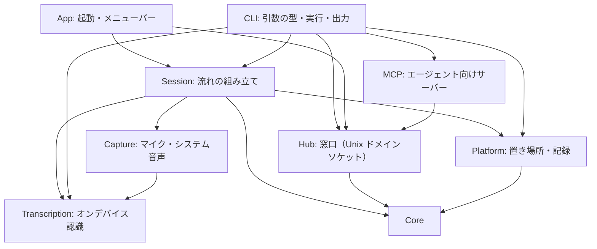

# 構成説明

meeting-analyzer の Module の責務・状態の所有・時間と並行・失敗の関係を説明する。要件は [SPEC.md](../SPEC.md) が正本であり、本書は選択済みの構成とその理由を述べる。API の保証や、動作の成功証拠ではない（証拠は [検証記録](verification.md)）。設計原則の出典と選択は [参考にした設計原則](references.md)。

**範囲**：本書は、いま実装されているもの（SPEC §8 で「実装済み」「実装済み・要人間確認」）の構成を述べる。画面の取り込み・自動終了は未実装で、置く場所の方針だけを「これから置く場所」に書く。

## Module と責務

外部パッケージはなく、Foundation・AVFoundation・Speech・ScreenCaptureKit・AppKit だけを使う。コードは SwiftPM の 4 つのターゲットに分かれる。

| ターゲット | 場所 | 役割 |
|---|---|---|
| `MeetingAnalyzer`（実行ファイル） | `Sources/MeetingAnalyzer/main.swift` | 引数を見て、GUI の起動か CLI の実行かを `MeetingAnalyzerApp` に任せるだけ |
| `MeetingAnalyzerKit`（ライブラリ） | `Sources/MeetingAnalyzerKit/` | アプリ本体。単体テストから `@testable import` で使う |
| `CaptureProbe`（実行ファイル） | `Sources/CaptureProbe/main.swift` | 取り込みの実験用（製品の CLI ではない）。マイク・システム音声・音声ファイルを実時間のライブ入力として認識し、遅延と音量を測る。権限は `--request` なしでは要求しない |
| `MeetingAnalyzerKitTests` | `Tests/MeetingAnalyzerKitTests/` | Swift Testing の単体テスト（`scripts/test.sh`） |

`MeetingAnalyzerKit` は、変わる理由ごとに 9 つのディレクトリへ分ける。**依存は上から下へだけ**向く。

| ディレクトリ | ファイル | 責務 | 持つ状態 |
|---|---|---|---|
| `Core/` | `AudioSelection`、`SystemSource` | 取り込む音声の選択（マイクのオン／オフ、システム音声のオフ／全体／アプリ）。流れ（本人・相手）と、開始できるか・説明を決める純粋な規則 | なし（値型） |
| | `Speaker`、`Utterance` | 発言者（本人／相手と表示名）と、1 つの発話（番号・本文・確定か・開始秒・版）。`key`（発言者と番号）が upsert の単位 | なし（値型） |
| | `ScreenSelection`、`ScreenSignature`、`ScreenChange` | 画面の取り込み先の選択と、画面の署名、前の画像から変化があったかの規則（格子の明るさの差が一定以上のものが一定数以上）。画面にも OS にも依存しない | なし（値型） |
| | `BatchMode` | 転送のまとめ方（発話の区切り／会話の区切り／約 30 秒／約 5 秒）。`BatchingPolicy` の値の組 | なし |
| | `EchoDetector` | 相手の声のマイクへの回り込みの疑いを、文字起こしの重なり（文字の 2 つ組）で見つける純粋な規則。判断だけで、発話は変えない | 直近 10 秒の「相手」の発話 |
| | `Batcher`、`BatchingPolicy` | 送るべき時を決める純粋な規則（SPEC §3.6）。`observe`（更新を受ける）・`isDue`・`takeBatch`・`flush`。**時計を持たず、`now`（秒）を引数で受ける**ので、時間を進めずにテストできる | 最新の発話・未送信の並び・最後の変化／送信の時刻・境界 |
| | `SessionLifecycle`、`EndReason` | セッションの状態遷移（待機・実行中・一時停止・終了）。順序以外は `TransitionError`。終了後は開始し直せない | `phase` |
| | `Transcript` | セッション全体の記録。upsert で溜め、開始時刻順に並べ、エージェントが読む Markdown にする | 発話の辞書 |
| | `TranscriptEvent`、`CaptionUpdate`、`EventSink` | エージェントへ渡す出来事（`started`・`captions`・`ended`）の JSON の形（`Codable`）と、それを受け取る口（`EventSink.publish`。**失敗しない**）。実機はハブ、テストは記録するだけの偽物 | なし |
| `Transcription/` | `AppleSpeechTranscriber`、`TranscriptionUpdate`、`SpeechReadiness` | `SpeechTranscriber`（オンデバイス）で音声ファイルを解析し、更新（確定前を含む）を `AsyncThrowingStream` で返す。言語が使えるかの確認。モデルが無ければ OS の仕組みで取得する。失敗は `TranscriptionError` | なし（呼ぶたびに、解析器を作る） |
| `Hub/` | `HubServer` | エージェントへ渡す窓口。アプリの中で、Unix ドメインソケット（ディレクトリ 0700・ソケット 0600・同じユーザーだけ。`getpeereid`）で待ち、出来事を、つながっている受け手すべてへ流す。直近の出来事（最大 2000 件）を、メモリ上だけに保持し、あとから接続した受け手へ先に渡す（`hello` → これまで → `sync` → 新しいもの）。新しいセッションの開始で、前のものを捨てる。受け手ごとの書き込みは、専用の待ち行列で行い、遅い・切れた受け手が、会議の処理を止めない。書き込みの失敗（EPIPE）で落ちないよう、SIGPIPE を無視する。**受け手が切れた直後の書き込みは、`SO_NOSIGPIPE` が設定できず、SIGPIPE でプロセスが終了する**（単体テストで再現し、直した） | 出来事のログ、受け手の一覧 |
| | `HubClient`、`HubWire`、`HubMessage` | 受け手側。窓口へつなぎ、1 行ずつ読んで流す。つながらない・切れたときは、間隔をあけて、つなぎ直す。1 行 1 件の JSON の形 | 接続（専用スレッド） |
| `MCP/` | `JSONText` | JSON の文章へ、**書式を保ったまま**（他のキー・並び・インデントそのまま）、オブジェクトのメンバーを足す・置き換える。文字列・括弧を数えて読み、コメントを見つけたら編集せず `nil`。編集後に、JSON として読み直して、意図した値になっているか確かめる | なし |
| | `AgentRegistration` | エージェントへ登録するコマンド・設定の文（実行ファイルのパスをシェル用に引用して入れる）。メニューが、クリップボードへ入れる | なし |
| | `MCPServer`、`MCPRunner` | エージェント向けの MCP サーバー（標準入出力の JSON-RPC）。窓口の出来事を保持し（最大 2000 件）、ツール `get_events`（カーソルより新しいもの）で返す。`--channel` では、接続後の新しい出来事を `notifications/claude/channel` で押し込む。ハブの識別子が変わったら、持っているものを捨てる。同じハブへのつなぎ直しでは、重複を入れない | 出来事のバッファ、カーソル、接続の状態 |
| `Platform/` | `RuntimePaths`、`SessionStore`、`ScreenshotStore` | 置き場所（環境変数が優先。データの置き場所・窓口のソケット）、記録の書き込み（ディレクトリ 0700・ファイル 0600）、画面の JPEG の保存（0700／0600・最新 30 枚・セッションの終了で全削除）。失敗は `Result` | なし |
| `Capture/` | `ScreenSnapshotter`、`ImageTools` | 画面の 1 枚撮り（ScreenCaptureKit。画面全体／アプリのいちばん大きいウィンドウ）と、画像の加工（48×27 の署名・1280 への縮小・JPEG）。画像はメモリ上だけで扱い、JPEG にするのは、渡す分だけ | なし |
| `Capture/` | `MicrophoneCapture`、`SystemAudioCapture`、`SystemAudioTarget`、`CaptureApp`、`CaptureError` | マイク（`AVAudioEngine`。ボイス処理＝エコー除去を有効にし、他のアプリの音の抑え込みを最小にする）と、システム音声（ScreenCaptureKit。全体、または選んだアプリ。自分の音は除く）を、`AsyncStream<AVAudioPCMBuffer>` で流す。音声はメモリ上だけ。権限の確認（`MicrophoneCapture.isAuthorized`、`ScreenRecordingPermission.isGranted`）は要求をしない。`start` は、権限が未確認なら OS の確認を出すので、利用者の開始の操作の中だけで呼ぶ | `AVAudioEngine`／`SCStream`（取り込み中だけ） |
| `Transcription/`（ライブ） | `updates(forLive:)`、`AudioFormatConverter` | バッファの流れを `SpeechAnalyzer` の入力へ渡す。形式の変換（多チャンネルは先頭のみ）を含む。実時間の入力では `.fastResults` が要る（[検証記録](verification.md#実施記録)）。更新の `start`／`end` は、その流れの最初のバッファを 0 とした秒数 | なし |
| `Session/` | `LiveSession`、`LiveInputs`、`LiveInputStream`、`LiveSessionNotice` | ライブのセッション 1 つ。`SessionLifecycle`・取り込みの流れ・`SessionPipeline`・時間を組み立てる。開始（取り込み）・一時停止（取り込みを止め、残りを確定して出し切る）・再開（時刻が続く）・終了（取り込みを止める → 出し切り → 記録 → 終了の出来事）。止めない失敗は `LiveSessionNotice` で知らせる。`LiveInputs` が、発言者ごとの「取り込み＋認識」の差し替え口（実機は `DeviceInputs`、テストは偽の流れ） | `SessionLifecycle`、`SessionPipeline`、発言者ごとの実行中の流れ、tick のタスク |
| `Session/` | `SessionPipeline` | 「更新 → 発話（番号・版） → バッチ → 出来事」と、終了の手順（出し切り → 記録 → `ended`）。入力がファイルの再生でもライブでも、同じ流れを通す。**同期**（`await` なし）。時計は、更新が持つ秒数 | 発言者ごとの番号、`Batcher`、`Transcript`、出したバッチ数 |
| `CLI/` | `Command`、`CommandParser`、`CLIError` | 引数を一度だけ検査して `Command` にする。失敗は終了コードを持つ `CLIError` | なし |
| | `LaunchableAgent`、`AgentSetup` | `meeting-analyzer pi\|omp\|agy\|opencode`：各エージェントの設定ファイルの場所・エントリの書式（pi・agy は `command`＋`args`、omp は `type`・`enabled` つき、opencode は `mcp` の map で `command` が配列）・登録済みかの判定（コマンドと引数だけ見る）・登録（`JSONText` で挿入し、最初の 1 回だけ元のファイルを控え、権限を保つ）。書けないときは、手で足す文を示す（`RegistrationOutcome.manual`） | なし |
| | `integrations/pi/meeting-analyzer.js`（アプリに同梱） | pi・omp の拡張。窓口へつなぎ（`getpeereid` で本人だけの窓口）、つないだあとの出来事を、セッションへ、`<channel …>` で囲んだメッセージとして、1 件ずつ、`followUp` で押し込む。つなぐ前にあった出来事は押し込まない。切れたら、2 秒ごとにつなぎ直す。出来事ごとに `note`（データであり、指示ではない）を添える | 接続・押し込んだ件数 |
| | `AgentLauncher` | `meeting-analyzer claude`：MCP の設定（JSON）と引数（利用者の引数が先頭、チャンネルの指定が最後）を作り、窓口が動いていなければ入れてあるアプリを `open -b` で起動し、プロセスを `claude` に置き換える（`execvp`）。設定ファイルは書き換えず、引数で、その起動だけに渡す。窓口の場所を環境変数で変えているときは、アプリを起動しない（検証・隔離） | なし |
| | `CLIRunner` | `Command` の実行（`mcp` は `MCPRunner` へ）。標準出力・標準エラー・文字起こしの部品を差し替えられる（検証とテスト用）。**失敗の見せ方（JSON・終了コード）を決める唯一の場所** | なし |
| `App/` | `Launch`（`MeetingAnalyzerApp`、`AppDelegate`） | 起動の入口。引数なしなら、アクセサリ（Dock に出ない）として起動し、メニューバーの項目を置く。CLI なら、実行して終了コードを返す。SIGTERM・メニューの終了は、同じ道（実行中の会議を `appQuit` で終えてから終了）を通す | `StatusMenu`、`MeetingController` |
| | `MeetingController` | メニューの操作を `LiveSession` へ結ぶ。**表示のための状態**（操作中か・知らせ・取り込む音声の選択）だけを持つ。会議の状態の所有者は `LiveSession` | `LiveSession`、選んだアプリ、知らせ |
| | `StatusMenu`、`FailureText` | メニュー（開くたびに状態から作り直す）、失敗の文言。**利用者への見せ方を決める境界**。開始は、確認のダイアログなしで、すぐ始まる | メニューバーの項目 |

### 取り込みと会議の接続

- 実機の入力は `LiveInputs.device(system:locale:)`（`Session/DeviceInputs.swift`）。言語が使えなければ、取り込みを始める前に断る。
- **時計**：音声の秒数は、流れごとに 0 から始まる。`LiveSession` は、各流れの原点を「取り込みが始まった時刻（会議の開始からの経過）」とし、更新の秒数に足して `SessionPipeline` へ渡す。一時停止をはさんでも、時刻（記録の `[mm:ss]`、`timestamp`）が続く。`tick` は、実時間（会議の開始からの経過）で、0.25 秒ごとに、**実行中のときだけ**回す。
- `CaptureProbe`（実行ファイル）は、取り込みの実験用で、製品の CLI ではない。マイク・システム音声・音声ファイルを実時間で認識し、遅延と音量を測る。

### これから置く場所（未実装）

- 自動終了（`silence`）：音声が一定時間なかったことの判定（`Core/` の純粋な規則）と、`LiveSession.end(reason: .silence)` の呼び出し。条件は SPEC §11 の未決。

### 設計原則との対応

[references.md](references.md) で選んだ原則が、コードのどこに現れているか。

| 原則 | 現れている場所 |
|---|---|
| 変わる理由で分ける | 上のディレクトリ分割。規則は `Core`、OS の事情は `Platform`、外部の窓口は `Hub`／`MCP`／`Transcription`、流れは `Session`、見せ方は `CLI`／`App` |
| 境界で一度だけ型にする | `CommandParser.parse`、`HubWire.decode`（受け手が受ける 1 行）、`TranscriptEvent` の `Codable`。内側は再検証しない |
| 常に有効な値 | `AudioSelection`（何も選ばれていない状態を `isEmpty` で表す）、`SessionLifecycle`（不正な遷移を作れない） |
| 集合の規則を 1 か所に | `Batcher`（まとめ方の規則）、`Transcript`（upsert と並び） |
| 教えて頼む | `Batcher.takeBatch` が送るものを決めて返す。`SessionPipeline.finish` が終わりの手順を持つ |
| 失敗を値で返す | `Result`・`throws` と小さな `enum`（`HubError`、`CaptureError`、`TranscriptionError`、`SessionStoreError`、`LiveSessionError`、`CLIError`）。見せ方を決めるのは `CLIRunner`（CLI）と `FailureText`・`Alerts`（メニュー）の境界だけ。**公開（`EventSink.publish`）は失敗しない**（受け手がいなくても、セッションは進む） |
| 目的が同じなら 1 つに | ファイルの再生もライブも、同じ `SessionPipeline`。`transcribe` と `replay` は、同じ文字起こしの部品 |

## 状態の所有

- 会議の流れの状態（発言者ごとの番号、未送信の発話、記録、送ったバッチ数）は、`SessionPipeline` だけが持つ。`Batcher` と `Transcript` は、その中の値型で、外から直接触らない。
- 会議の状態遷移（`SessionLifecycle`）は、`LiveSession` が持つ。メニューの操作は、`MeetingController` 経由で `LiveSession` の `start`／`pause`／`resume`／`end` を呼び、順序以外の操作は `LiveSessionError.invalidState` で断る。終了した `LiveSession` は使い回さず、次の会議は新しいものを作る。
- 記録のファイルは、`SessionPipeline.finish` が 1 回だけ書く。途中では書かない（途中の本文を、ディスクに残さない）。
- 窓口の出来事のログと受け手の一覧は、`HubServer` だけが持つ（ロックで守る）。`sequence`（バッチ）は `SessionPipeline`、通し番号（`id`）は `HubServer` が決める。

## 時間と並行

- 時計は `Core` が持たない。`Batcher` は `now` を受け、`SessionPipeline` は、更新が持つ秒数（セッションの開始からの経過）を使う。ファイルの再生は、音声の時間で進むので、処理が速くても、まとめ方の規則が実時間と同じに働く。
- `SessionPipeline.ingest` は、更新を受けるたびに、まず `tick`（前の更新からの静けさが十分なら、前の発話を、この更新を混ぜずに先に送る）、次に `observe`、最後に境界の確認をする。
- 認識は、`AsyncThrowingStream` として流れる。ストリームが終われば、終了の手順に進む。中断されたら、解析のタスクも取り消される。
- 出来事の公開は同期で、失敗しない（`HubServer.publish` は、ログへ追加し、各受け手の待ち行列へ入れるだけ）。受け手が遅くても、会議の処理は待たない。
- `SessionPipeline` は `@unchecked Sendable` で、**同時に 1 つの呼び出しだけが入る前提**。パイプラインが同期なので、`LiveSession`（actor）の中で呼べば、本人・相手の 2 つの流れの更新が、割り込み合わない（`await` をはさまないから）。
- 取り込みの停止は、`stop` → 認識が残りを確定して終わるのを待つ（`finalizeTimeout`＝5 秒で打ち切る）。終了・一時停止は、これを済ませてから状態を変える。

## 失敗の扱い

失敗は、`Result`・`throws` と小さな `enum` で返す。終了コード・メッセージ・メニューの文言を決めるのは境界（`CLIRunner`、`App/`）だけ。

| 状況 | 振る舞い |
|---|---|
| 音声ファイルを開けない | `TranscriptionError.unreadableAudio`／事前の確認で `CLIError.input`（終了コード 2）。何も送らない |
| 言語が使えない・モデルを用意できない・認識が失敗 | `TranscriptionError` → 終了コード 4。**記録も書かず、終了の出来事も出さない** |
| 窓口が使用中（実行中のアプリがある）・開けない・パスが長すぎる | `HubError` → `CLIError.hub`（終了コード 3）。何も始めない。アプリでは、メニューの知らせに出し、記録だけ続ける |
| 受け手がいない・切れた | 何も起きない（出来事は保持され、後から接続した受け手が先頭から読める） |
| 記録を書けない | 記録のパス無しで `ended` を出す（終わりは伝える）。書けなかった事実は、パスが無いことで表れる |
| 何も話されなかった | バッチは出さず、`ended` は出す（記録のパスは無し） |
| 空白だけの更新 | 無視する |
| 会議の途中で、片方の取り込み・認識が止まった | `LiveSessionNotice`（メニューの 1 行）で知らせる。もう片方と会議は続く（利用者が、終了するか決める） |
| 開始できない（権限・言語・選んだアプリ） | 何も始めず（開いた取り込みも止める）、待機のまま。ダイアログで原因と対処を示す |
| 想定外のエラー | `internal` として、終了コード 1 で返す（握り潰さない） |

## 既知の制約

- 記録の保持期間・削除の方法が未決（SPEC §11）。いまは、残り続ける。
- `version` は、確定前の更新のたびに増える（1 つの発話で数十になる）。受け手は、`id` で upsert し、最新の `version` だけを使う。
- 窓口の保持は 2000 件まで。長いセッションで超えると、古い字幕のバッチから消える（記録のファイルには、全文が残る）。
- 開始時刻の表示は、UTC の ISO 8601。
- ソケットのパスは 103 バイトまで（`sockaddr_un`）。データの置き場所を深い場所へ変えるときは、`MEETING_ANALYZER_SOCKET` を使う。
- 言語モデルが未取得だと、初回の文字起こしが、取得のために遅れる（ネットワークが要る）。`doctor` の `installed` で、事前に分かる。
