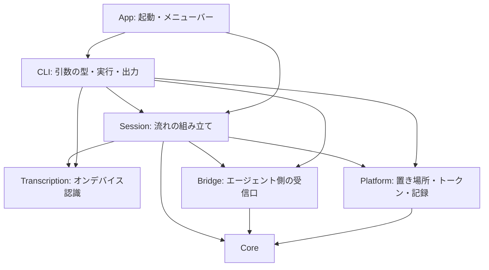

# 構成説明

meeting-analyzer の Module の責務・状態の所有・時間と並行・失敗の関係を説明する。要件は [SPEC.md](../SPEC.md) が正本であり、本書は選択済みの構成とその理由を述べる。API の保証や、動作の成功証拠ではない（証拠は [検証記録](verification.md)）。設計原則の出典と選択は [参考にした設計原則](references.md)。

**範囲**：本書は、いま実装されているもの（SPEC §8 で「実装済み」）の構成を述べる。マイク・システム音声・画面の取り込みの本接続と、メニューの操作は未実装。ただし、取り込みの部品（`Capture/`、ライブ入力の認識）は、実験用の `CaptureProbe` からだけ使われる試作としてあり、アプリ（`SessionPipeline`・メニュー）へは接続していない（「取り込みの試作」）。

## Module と責務

外部パッケージはなく、Foundation・AVFoundation・Speech・ScreenCaptureKit・AppKit だけを使う。コードは SwiftPM の 4 つのターゲットに分かれる。

| ターゲット | 場所 | 役割 |
|---|---|---|
| `MeetingAnalyzer`（実行ファイル） | `Sources/MeetingAnalyzer/main.swift` | 引数を見て、GUI の起動か CLI の実行かを `MeetingAnalyzerApp` に任せるだけ |
| `MeetingAnalyzerKit`（ライブラリ） | `Sources/MeetingAnalyzerKit/` | アプリ本体。単体テストから `@testable import` で使う |
| `CaptureProbe`（実行ファイル） | `Sources/CaptureProbe/main.swift` | 取り込みの実験用（製品の CLI ではない）。マイク・システム音声・音声ファイルを実時間のライブ入力として認識し、遅延と音量を測る。権限は `--request` なしでは要求しない |
| `MeetingAnalyzerKitTests` | `Tests/MeetingAnalyzerKitTests/` | Swift Testing の単体テスト（`scripts/test.sh`） |

`MeetingAnalyzerKit` は、変わる理由ごとに 7 つのディレクトリへ分ける。**依存は上から下へだけ**向く。

| ディレクトリ | ファイル | 責務 | 持つ状態 |
|---|---|---|---|
| `Core/` | `Speaker`、`Utterance` | 発言者（あなた／相手と表示名）と、1 つの発話（番号・本文・確定か・開始秒・版）。`key`（発言者と番号）が upsert の単位 | なし（値型） |
| | `Batcher`、`BatchingPolicy` | 送るべき時を決める純粋な規則（SPEC §3.6）。`observe`（更新を受ける）・`isDue`・`takeBatch`・`flush`。**時計を持たず、`now`（秒）を引数で受ける**ので、時間を進めずにテストできる | 最新の発話・未送信の並び・最後の変化／送信の時刻・境界 |
| | `SessionLifecycle`、`EndReason` | 会議の状態遷移（待機・実行中・一時停止・終了）。順序以外は `TransitionError`。終了後は開始し直せない | `phase` |
| | `Transcript` | 会議全体の記録。upsert で溜め、開始時刻順に並べ、エージェントが読む Markdown にする | 発話の辞書 |
| `Transcription/` | `AppleSpeechTranscriber`、`TranscriptionUpdate`、`SpeechReadiness` | `SpeechTranscriber`（オンデバイス）で音声ファイルを解析し、更新（確定前を含む）を `AsyncThrowingStream` で返す。言語が使えるかの確認。モデルが無ければ OS の仕組みで取得する。失敗は `TranscriptionError` | なし（呼ぶたびに、解析器を作る） |
| `Bridge/` | `CaptionBatch`、`EndEvent` | ブリッジへ送る JSON の形（`Encodable`）。`make` が、発話・セッションの情報から作る | なし |
| | `BridgeEndpoint` | 送り先。`parse` が、`http://127.0.0.1`／`localhost` だけ・トークン 32 文字以上・空白なしを、境界で一度だけ検査して型にする | なし |
| | `BridgeClient`、`BridgeSending`、`BridgeError` | `/health`・`/captions`・`/end`。応答を `BridgeError`（接続できない・認証・受け付けられない・拒否）に分類する。`BridgeSending` は、差し替えが要る箇所（テスト）だけのプロトコル | `URLSession` |
| `Platform/` | `RuntimePaths`、`TokenStore`、`SessionStore` | 置き場所（環境変数が優先）、トークンの読み取り（保存・表示しない）、記録の書き込み（ディレクトリ 0700・ファイル 0600）。失敗は `Result` | なし |
| `Session/` | `SessionPipeline` | 「更新 → 発話（番号・版） → バッチ → ブリッジ」と、終了の手順（出し切り → 記録 → 合図）。入力がファイルの再生でもライブでも、同じ流れを通す。時計は、更新が持つ秒数 | 発言者ごとの番号、`Batcher`、`Transcript`、送ったバッチ数 |
| `CLI/` | `Command`、`CommandParser`、`CLIError` | 引数を一度だけ検査して `Command` にする。失敗は終了コードを持つ `CLIError` | なし |
| | `CLIRunner` | `Command` の実行。標準出力・標準エラー・文字起こし・送信の部品を差し替えられる（検証とテスト用）。**失敗の見せ方（JSON・終了コード）を決める唯一の場所** | なし |
| `App/` | `Launch`（`MeetingAnalyzerApp`、`AppDelegate`）、`StatusMenu` | 起動の入口。引数なしなら、アクセサリ（Dock に出ない）として起動し、メニューバーの項目を置く。CLI なら、実行して終了コードを返す | `StatusMenu` の項目 |

### 取り込みの試作（アプリへは未接続）

- `Capture/`：`MicrophoneCapture`（`AVAudioEngine`。ボイス処理を有効にし、他のアプリの音の抑え込みを最小にする）と `SystemAudioCapture`（ScreenCaptureKit。選んだアプリの音だけ。自分の音は除く）。どちらも `AsyncStream<AVAudioPCMBuffer>` を返し、音声はメモリ上だけで扱う。権限の確認（`MicrophoneCapture.isAuthorized`、`ScreenRecordingPermission.isGranted`）は、要求をしない。`start` は、権限が未確認なら OS の確認を出すので、利用者の開始の操作の中だけで呼ぶ。
- `Transcription/LiveTranscription.swift`：バッファの流れを `SpeechAnalyzer` の入力へ渡す。形式の変換（`AudioFormatConverter`。多チャンネルは先頭のみ）を含む。実時間の入力では `.fastResults` が要る（[検証記録](verification.md#実施記録)）。更新の `start`／`end` は、**その流れの最初のバッファを 0 とした秒数**。

これからの接続（未実装）：

- 更新は、`SessionPipeline.ingest` に、`Speaker`（マイク＝あなた、システム音声＝相手）つきで入る。**時計の課題**：`SessionPipeline` は、更新の秒数を時計に使うが、マイクとシステム音声は、別の流れで、それぞれ 0 から始まる。接続のとき、会議の開始からの経過で揃える（開始の時刻で、各流れの原点を決める）。
- 画面：同じく `Capture/`。変化の検知（画面の署名の比較）は、画面にも OS にも依存しない純粋な規則として `Core/` に置き、取り込みだけを `Capture/` に置く。
- メニューの操作・同意の確認：`App/`。会議の状態は `SessionLifecycle` が持ち、`App/` は表示と操作の受け渡しだけをする。
- 時間（`tick`）：ライブでは、`SessionPipeline.tick(at:)` を、定期的（0.25 秒程度）に呼ぶ。メイン実行ループで動かし、会議が実行中でないときは動かさない。

### 設計原則との対応

[references.md](references.md) で選んだ原則が、コードのどこに現れているか。

| 原則 | 現れている場所 |
|---|---|
| 変わる理由で分ける | 上のディレクトリ分割。規則は `Core`、OS の事情は `Platform`、外部の窓口は `Bridge`／`Transcription`、流れは `Session`、見せ方は `CLI`／`App` |
| 境界で一度だけ型にする | `CommandParser.parse`、`BridgeEndpoint.parse`、`TokenStore.read`。内側は再検証しない |
| 常に有効な値 | `BridgeEndpoint`（ローカルだけ・トークンの形）、`SessionLifecycle`（不正な遷移を作れない） |
| 集合の規則を 1 か所に | `Batcher`（まとめ方の規則）、`Transcript`（upsert と並び） |
| 教えて頼む | `Batcher.takeBatch` が送るものを決めて返す。`SessionPipeline.finish` が終わりの手順を持つ |
| 失敗を値で返す | `Result`・`throws` と小さな `enum`（`BridgeError`、`TranscriptionError`、`TokenError`、`SessionStoreError`、`CLIError`）。見せ方を決めるのは `CLIRunner` だけ |
| 目的が同じなら 1 つに | ファイルの再生もライブも、同じ `SessionPipeline`。`transcribe` と `replay` は、同じ文字起こしの部品 |

## 状態の所有

- 会議の流れの状態（発言者ごとの番号、未送信の発話、記録、送ったバッチ数）は、`SessionPipeline` だけが持つ。`Batcher` と `Transcript` は、その中の値型で、外から直接触らない。
- 会議の状態遷移（`SessionLifecycle`）は、まだ `SessionPipeline` とつながっていない（GUI の実装時に、開始・一時停止・終了の操作と結ぶ）。
- 記録のファイルは、`SessionPipeline.finish` が 1 回だけ書く。途中では書かない（途中の本文を、ディスクに残さない）。
- `BridgeClient` は、通信の状態を持たない（`URLSession` だけ）。`sequence` は `SessionPipeline` が決める。

## 時間と並行

- 時計は `Core` が持たない。`Batcher` は `now` を受け、`SessionPipeline` は、更新が持つ秒数（セッションの開始からの経過）を使う。ファイルの再生は、音声の時間で進むので、処理が速くても、まとめ方の規則が実時間と同じに働く。
- `SessionPipeline.ingest` は、更新を受けるたびに、まず `tick`（前の更新からの静けさが十分なら、前の発話を、この更新を混ぜずに先に送る）、次に `observe`、最後に境界の確認をする。
- 認識は、`AsyncThrowingStream` として流れる。ストリームが終われば、終了の手順に進む。中断されたら、解析のタスクも取り消される。
- ブリッジへの送信は、順番に 1 つずつ待つ（`await`）。送信が失敗したら、そこで止まり、失敗が呼び出し側へ伝わる（SPEC の「失敗した再生を、正常な終了として知らせない」）。
- `SessionPipeline` は `@unchecked Sendable` で、**同時に 1 つの呼び出しだけが入る前提**（1 つの会議を、1 つの流れで処理する）。複数のスレッドから同時に呼ばない。ライブの実装では、メイン実行ループか専用の直列キューから呼ぶ。

## 失敗の扱い

失敗は、`Result`・`throws` と小さな `enum` で返す。終了コード・メッセージ・メニューの文言を決めるのは境界（`CLIRunner`、将来の `App/`）だけ。

| 状況 | 振る舞い |
|---|---|
| 音声ファイルを開けない | `TranscriptionError.unreadableAudio`／事前の確認で `CLIError.input`（終了コード 2）。何も送らない |
| 言語が使えない・モデルを用意できない・認識が失敗 | `TranscriptionError` → 終了コード 4。**終了の合図を送らない** |
| 送り先が `127.0.0.1` 以外／トークンが読めない・短い | `CLIError.bridge`（終了コード 3）。通信しない |
| ブリッジが落ちている・トークン違い・503 | 文字起こしを始める前の `/health` で止まる（終了コード 3）。途中で起きたら、そこで止まる |
| 記録を書けない | 記録のパス無しで終了の合図を送る（会議の終わりは伝える）。書けなかった事実は、パスが無いことで表れる |
| 何も話されなかった | バッチは送らず、終了の合図は送る（記録のパスは無し） |
| 空白だけの更新 | 無視する |
| 想定外のエラー | `internal` として、終了コード 1 で返す（握り潰さない） |

## 既知の制約

- 記録の保持期間・削除の方法が未決（SPEC §11）。いまは、残り続ける。
- `messageVersion` は、確定前の更新のたびに増える（1 つの発話で数十になる）。ブリッジは、版の大きさを気にしない（`>= 0` の整数）。
- 開始時刻の表示は、UTC の ISO 8601。
- 言語モデルが未取得だと、初回の文字起こしが、取得のために遅れる（ネットワークが要る）。`doctor` の `installed` で、事前に分かる。
